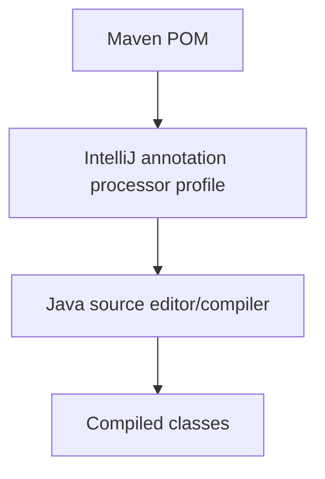

# Why `.idea/compiler.xml` Changed

## Overview

`.idea/compiler.xml` is IntelliJ IDEA metadata. It controls IDE annotation processing and is not used by Eureka, the API Gateway, or the running Spring Boot services.

## Problem Statement

After IntelliJ re-imported the Maven projects, it detected Lombok in the services and regenerated annotation-processing profiles.

## Existing Flow

Maven reads Lombok and the compiler configuration from each service's `pom.xml`. IntelliJ independently creates `.idea/compiler.xml` so its editor and IDE compiler can understand generated Lombok code.

## New Flow

IntelliJ now has a separate annotation-processing profile for `inventory-services` and keeps `orders-services` in its own profile.


## Folder Structure

```text
.idea/compiler.xml       # IDE-only compiler metadata
orders-services/pom.xml  # Maven build source of truth
inventory-services/pom.xml
```

## Request Flow

This file is not part of an HTTP request flow. It affects local IDE compilation only.

## Component Diagram



## Code Walkthrough

- The new inventory profile associates `inventory-services` with Lombok's annotation processor.
- The orders profile keeps orders associated with Lombok.
- The repeated Lombok entry in the orders profile is IDE configuration duplication. It has no application behavior and is not required by Maven.
- The source code and runtime service configuration are unchanged by this file.

## Important APIs

There are no application APIs in this XML file. Lombok annotations are processed during compilation, while Spring Boot runs the generated bytecode afterward.

## Edge Cases

- IntelliJ may regenerate this file after Maven re-import.
- Different IntelliJ versions may format or reorganize annotation profiles.
- A missing Lombok processor can cause false IDE errors even when Maven builds successfully.

## Common Mistakes

- Treating `.idea/compiler.xml` as Spring configuration.
- Manually editing it to fix application behavior.
- Committing IDE-only churn when Maven already contains the required configuration.
- Assuming generated IDE metadata is portable across developers and IDEs.

## Performance Notes

This affects only local IDE compilation and has no production runtime performance impact.

## Interview Questions

1. What is annotation processing?
2. Why does Lombok require an annotation processor?
3. What is the difference between Maven configuration and IntelliJ metadata?
4. Why should generated IDE files usually not be part of the build contract?

## Summary

The diff was caused by IntelliJ detecting Lombok in `inventory-services` during Maven synchronization. It is not required for gateway or Eureka functionality. If Maven builds successfully, this IDE-only change can normally be reverted and should not be treated as an application code change.
